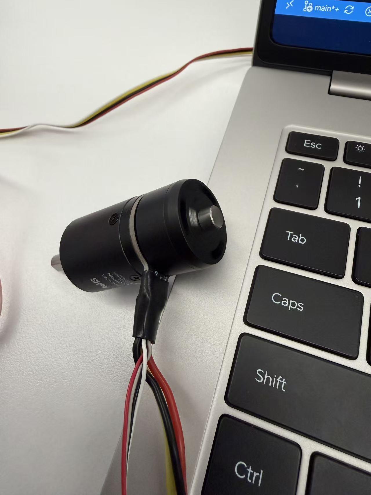

## 1. USART1 接收初次修改
- 在 `bsp/src/bsp_usart.cpp` 增加 USART1 Receive-to-Idle DMA 启动及接收回调。
## 2. USART1/USART6 DMA 初始化
- 为两路 UART 增加独立静态接收缓冲区。
- 调用 CubeMX 初始化函数，启动 Receive-to-Idle DMA，并关闭 DMA 半传输中断。
## 3. PWM 封装实现
- 在 `bsp/src/bsp_pwm.cpp` 实现 TIM1 PWM 初始化、通道启停、周期换算和占空比设置。
## 4. USART 收发接口修正
- 修正 DMA 接收长度和 HAL 状态码检查，统一阻塞模式枚举名称。
- 在 `bsp/src/bsp_usart.cpp` 实现阻塞、IT、DMA 发送/接收模式分发，并添加 Receive-to-Idle 回调重启。
## 5. 根目录 CMake 入口修复
- 将根目录 `CMakeLists.txt` 改为委托构建 `board` 子工程。
- 将根目录 `CMakePresets.json` 的 ARM 工具链路径改为 `board/cmake/gcc-arm-none-eabi.cmake`。
## 6. CAN 收发与反馈路由
- 配置并启动 CAN1/CAN2，启用 FIFO0 接收通知，提供标准帧发送接口和参数/状态检查。
## 7. PID 与数值函数
- 实现位置式、增量式 PID，支持误差历史、积分限幅、输出限幅、状态清零及在线调参。
## 8. BMI088 驱动
- 实现 SPI 寄存器读写、双芯片片选、软复位、ID 校验和量程/采样配置。
## 9. 电机管理与 M2006 控制
- 实现电机注册、CAN 控制帧分组打包、反馈解析、编码器回绕及位置累计。
- 实现 M2006 速度环、位置-速度串级控制、电流限幅和反馈在线检查。
## 10. LED 与应用任务
- 实现低电平有效的 RGB LED 控制和供 C 代码使用的接口。
- 新增 BMI088 任务接口与单电机控制任务；位置目标须在首帧编码器反馈后设置。
## 11. ThreadX 线程与心跳监控
- 创建 UART、IMU、电机控制和 Alive Monitor 线程及所需信号量。
## 12. 通信和线程状态修正
- 将 UART DMA 启动消息改为通过 BSP 发送接口；发送/初始化状态用于上层判定。

BMI088调试阶段：
## 1. 
第一次上机调试发现BMI088没有任何反应和接收到的数据,输入g_imu_sample也没有任何返回值,各种三维数据都暂时没有返回实时的值，暂时把其他线程关闭，然后只保留BMI088的线程运行

## 2. 
ThreadX 已经运行，BMI088 加速度计的芯片 ID 读取失败，程序尚未开始采样，移动传感器不会让当前的三轴数值变化。

## 3. 
现在已经能够读取到传感器的数据，acc_chip_id 应为 30（0x1E），gyro_chip_id 应为 15（0x0F）。
BMI088传感器的ID数据已经正常

## 4.
在CORTEX LIVE WATCH添加 g_imu_sample.accel[0,1,2]、g_imu_sample.gyro[0,1,2]表达式后，已经能够看到了角加速度和加速度的实时变化，并且也是让它跑在线程上的，暂时没有什么问题。

M2006电机调试阶段：
## 1.电机暂时没有旋转
程序只创建电机线程，电机默认松开、输出零电流
g_m2006_debug.requested_mode = 0，所以需要增加输出的电流让电机旋转

## 2.电机仍然未能旋转
feedback_frames=0，所以电机一直被判为离线，双环控制保持零输出。

## 3.
经过检查发现ID搞错了，应该是203 结果弄成201了，把这个修改过来后发现电机能够正常旋转，按照我设置好的速度进行旋转，现在开始对电机的CAN报文，反馈解析和双环控制进行调试

## 4.
有返回的CAN的ID值但是没有返回实时的曲线，反馈进入里线程

## 5.!(<屏幕截图 2026-10-11 171735.png>)
已添加目标和反馈，现在是简单的直线reference，误差很小，没有任何问题，下一步准备使用三角波reference来对PID进行调参

## 6.!(<屏幕截图 2026-10-11 172546.png>)
已经将reference的波形改为正弦波，但是拟合程度仍然不好，需要对其深入调参

